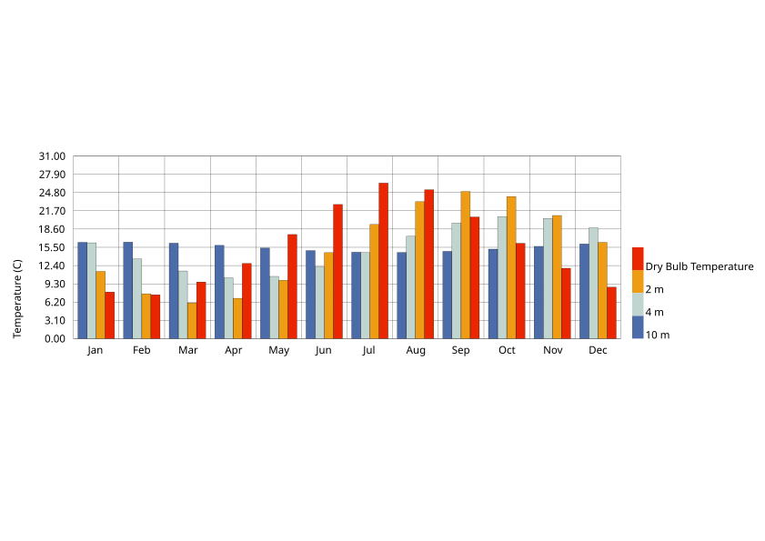
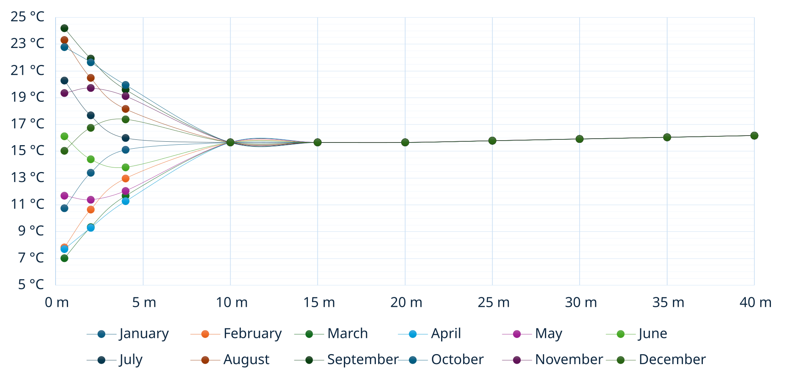
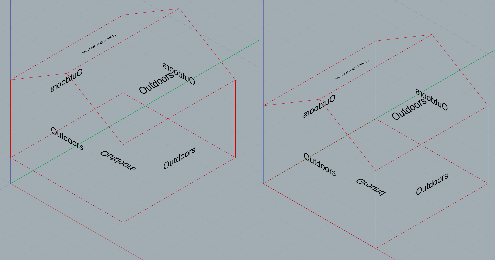
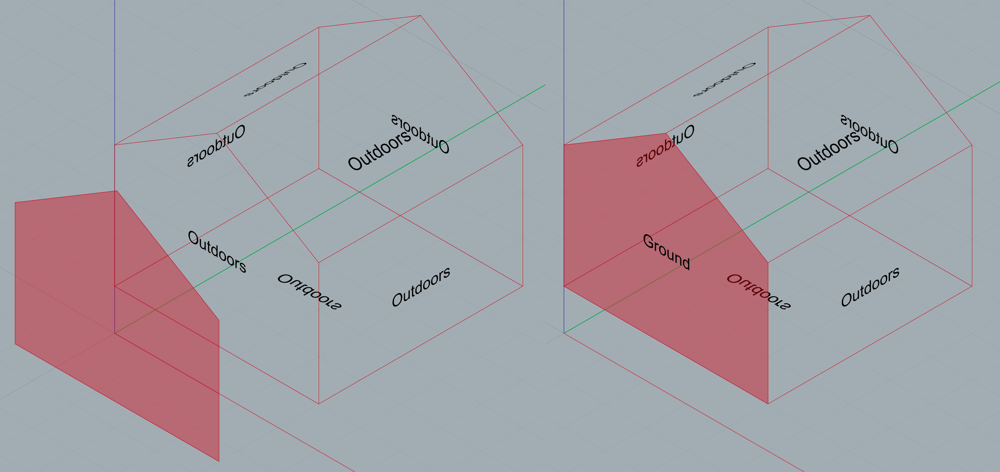
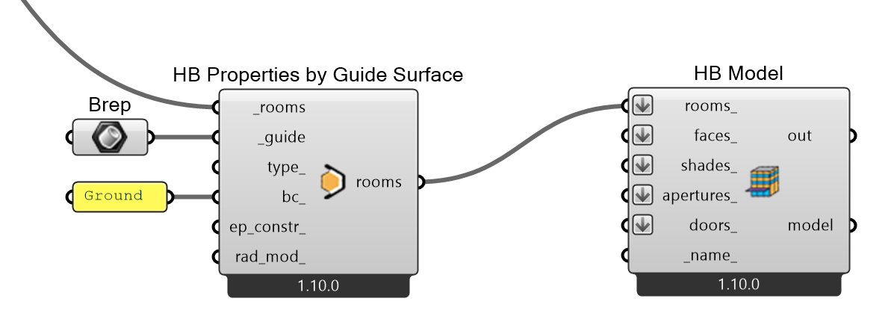
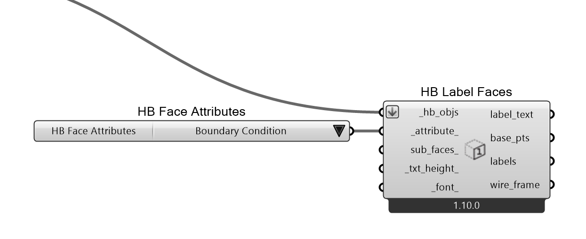
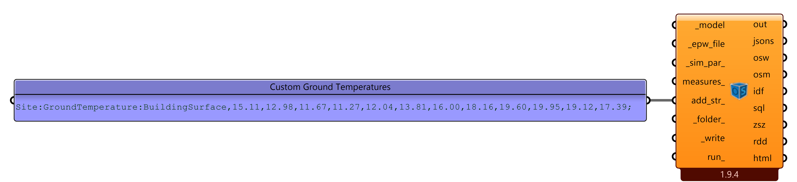

# Ground Temperature and Earth Berming

Ground temperatures can be of use to either warm or cool a space, since they vary less than outdoor air temperatures.
The deeper you go, the more stable temperatures become.




## Set up energy model
#### Default
To define where a building meets the ground, honeybee by default assigns a ```ground boundary condition``` to faces which are located below a height of 0 (z=0).


#### Custom
We can also assign a ```ground boundary condition``` with a ```guide surface``` which covers the desired faces of the model and a **```HB Properties by Guide Surface```** component.



#### Check
To visualize, which ```boundary condition``` a face has, we can use the **```HB Label Faces```** Component:


## Set up simulation
#### Default
By default, honeybee assumes a temperature of $18°C$ throughout the year for all depths.

#### Custom
To set ground temperatures by hand, use the ```add_str_``` input on the **```HB Model to OSM```** component and connect a panel with your temperatures, like so:
```
Site:GroundTemperature:BuildingSurface,
  18.0,  !- January
  17.5,  !- February
  15.0,  !- March
  12.0,  !- April
  10.0,  !- May
  9.0,   !- June
  9.5,   !- July
  11.0,  !- August
  13.0,  !- September
  15.0,  !- October
  16.5,  !- November
  17.5;  !- December
```



To do this automatically with ground temperatures from the ```EPW``` (for depths of 0.5 m, 2 m and 4 m), components are already provided in the [ground_temp_and_earth_berming.gh](ground_temp_and_earth_berming.gh) example file.

#### Approximate Ground Temperatures
For depths below 4 m, we can **approximate(!)** ground temperatures with the following formula (Labs, 1779):

$T(x,t) = T_m - A_s \cdot e^{-x \sqrt{\frac{\pi}{365\alpha}}} \cdot \cos\left(\frac{2\pi}{365} \left[ t - t_o - \frac{x}{2} \sqrt{\frac{365}{\pi\alpha}} \right]\right)$, where:

* $T_{(x t)}$ = Ground temperature at depth $x$ and day $t$
* $T_m$ = mean annual temperature of the ground
* $A_s$ = annual range of the surface temperature
* $t$ = day of the year
* $t_o$ = day with minimum surface temperature
* $a$ ($\alpha$) = soil thermal diffusivity
* $x$ = depth below the ground surface

Components are also provided in the example file.

> Use this for depths below 10 m, accuracy varies for shallower depths.

## Example File
The provided [ground_temp_and_earth_berming.gh](ground_temp_and_earth_berming.gh) includes two experiments.
#### Basement
A building where you can choose if and how deep in the ground it sits. Try different depths and note the difference in energy usage. Also try to vary the climate in which the simulation is run to see differences between cold and hot climates.

#### Earth Berming
A building where you decide which sides are covered by ground and which have windows. Run trough all possibilities and note the differences in energy usage. This experiment is also a good candidate to try optimization with **```galapagos```**.

